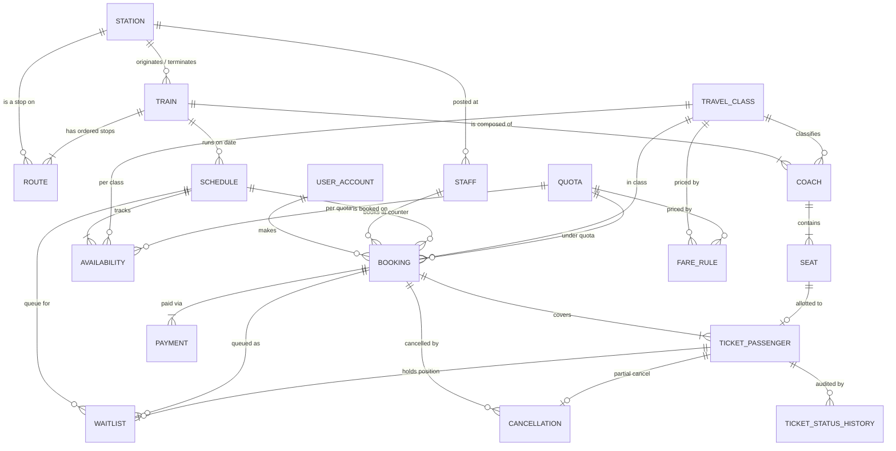
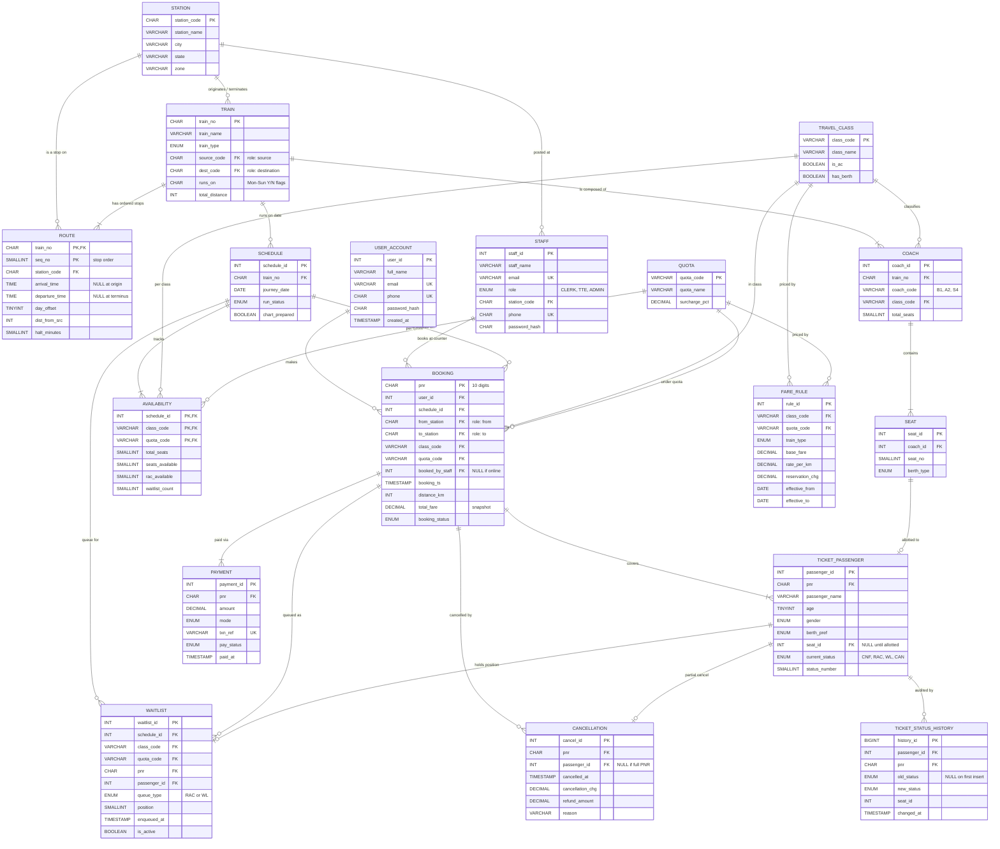

# Railway Reservation & PNR Management System

An Indian-Railways-style reservation system: train schedules, seat inventory, PNR booking, RAC and
waitlist queues, fare computation, payments and cancellations. MySQL 8, Next.js 15 and Redis.

---

## Table of Contents

1. [Problem Statement](#1-problem-statement)
2. [Target Users](#2-target-users)
3. [Key Queries the Database Must Serve](#3-key-queries-the-database-must-serve)
4. [ER Diagram](#4-er-diagram)
5. [ER Design Decisions](#5-er-design-decisions)
6. [Relational Schema](#6-relational-schema)
7. [ER → Relational Mapping Rules Applied](#7-er--relational-mapping-rules-applied)
8. [Database Implementation](#8-database-implementation)
9. [How to Run](#9-how-to-run)
10. [API](#10-api)
11. [Repository Structure](#11-repository-structure)
12. [Technology Choices](#12-technology-choices)
13. [Known Limitations](#13-known-limitations)

---

## 1. Problem Statement

Indian Railways handles millions of daily bookings across thousands of trains, yet manual or
fragmented ticketing leads to double-booked seats, untracked waitlists, and no reliable record of
cancellations or refunds. This project builds a centralized relational database to manage the
complete reservation lifecycle.

The system stores train details, their routes across ordered stations, coach and class-wise seat
inventory, and per-date schedules with dynamic availability. Passengers register once and book
tickets against a specific train, journey date, and boarding/destination pair; the database
generates a unique PNR, allots seats when available, and pushes the booking to a waitlist or RAC
queue otherwise. Cancellations automatically free the seat and promote the next waitlisted
passenger. Fare is computed from distance, class, and quota, and every payment or refund is logged
for audit. Integrity constraints prevent overbooking, duplicate seat allotment, and invalid station
sequences, while indexed lookups keep availability searches fast during peak booking windows.

## 2. Target Users

| User | What they do with the system |
|---|---|
| **Passenger** | Search trains, book and cancel tickets, track PNR status |
| **Reservation Clerk** | Counter bookings, modifications, refund processing |
| **Railway Administrator** | Configure trains, routes, coach composition, fare rules |
| **Ticket Examiner (TTE)** | Verify onboard seat allotment and passenger identity |

## 3. Key Queries the Database Must Serve

1. **Availability search** — for a given source, destination and date, list all trains passing
   through both stations *in the correct order*, with seats available per class.
2. **PNR status** — retrieve full booking details for a PNR: passengers, coach, seat numbers,
   CNF/RAC/WL status and current waitlist position.
3. **Waitlist promotion** — on cancellation, find the earliest-booked waitlisted passenger for that
   schedule, class and quota, and allot the freed seat.
4. **Occupancy report** — for a given train and date, compute class-wise seats booked, seats vacant
   and percentage occupancy.
5. **Revenue analytics** — total fare collected minus refunds, grouped by train and month, listing
   the top-earning routes.
6. **Passenger history** — all bookings by a user in the last year with journey details and
   cancellation/refund status.

These six queries drove the schema: note how `ROUTE.seq_no` exists purely to make query 1 correct,
and `WAITLIST.position` + `enqueued_at` exist to make query 3 deterministic.

---

## 4. ER Diagram

Print-quality exports: **[ER_diagram.pdf](docs/ER_diagram.pdf)** and **[Relational_schema.pdf](docs/Relational_schema.pdf)**. Both are generated from [`docs/er-diagram.mmd`](docs/er-diagram.mmd) by `python docs/generate_pdfs.py`, so the diagram, the schema document and this README cannot drift apart.

### Overview — entities and relationships



### Full ER diagram with attributes



> GitHub renders this Mermaid block as a diagram automatically. The same source lives in
> `docs/er-diagram.mmd`; run `python docs/generate_pdfs.py` to rebuild the colour-coded PDF exports.

### Reading the diagram

- `||--|{` = one-to-many with **total** participation on the many side (every coach *must* have seats).
- `||--o{` = one-to-many with **optional** participation (a station *may* have no trains starting there).
- `||--o|` = one-to-**zero-or-one** (a seat is allotted to at most one passenger).

## 5. ER Design Decisions

| Construct | Where it appears | Justification |
|---|---|---|
| **Weak entity** | `ROUTE` (identified by `TRAIN` + `seq_no`), `SEAT` (dependent on `COACH`) | A stop has no meaning without its train; a seat has none without its coach. |
| **Recursive / dual role** | `STATION` is both *source* and *destination* of a `TRAIN`, and both *from* and *to* of a `BOOKING` | Same entity set participating in one relationship under two distinct roles. |
| **Ternary → relationship entity** | `AVAILABILITY` (SCHEDULE × TRAVEL_CLASS × QUOTA) | A seat count is meaningful only for the combination of all three; no pair determines it. |
| **Multivalued attribute → table** | `TICKET_PASSENGER` | One PNR carries up to six passengers, each with their own seat and status. |
| **Aggregation** | `WAITLIST` refers to the *booking-on-a-schedule* relationship | A queue position is a property of a passenger already related to a schedule. |
| **Total participation** | `COACH`–`SEAT`, `BOOKING`–`TICKET_PASSENGER` | Every coach has seats; every PNR has at least one passenger. |
| **Temporal snapshot** | `BOOKING.distance_km`, `BOOKING.total_fare` | Fare rules change over time; the ticket must retain the price actually charged. |

---

## 6. Relational Schema

Primary keys in **bold**; foreign keys marked *(FK → Table)*.

1. **STATION**(**station_code**, station_name, city, state, zone)

2. **TRAIN**(**train_no**, train_name, train_type, source_code *(FK → STATION)*, dest_code *(FK → STATION)*, runs_on, total_distance)

3. **ROUTE**(**train_no** *(FK → TRAIN)*, **seq_no**, station_code *(FK → STATION)*, arrival_time, departure_time, day_offset, dist_from_src, halt_minutes)

4. **TRAVEL_CLASS**(**class_code**, class_name, is_ac, has_berth)

5. **QUOTA**(**quota_code**, quota_name, surcharge_pct)

6. **COACH**(**coach_id**, train_no *(FK → TRAIN)*, coach_code, class_code *(FK → TRAVEL_CLASS)*, total_seats)

7. **SEAT**(**seat_id**, coach_id *(FK → COACH)*, seat_no, berth_type)

8. **SCHEDULE**(**schedule_id**, train_no *(FK → TRAIN)*, journey_date, run_status, chart_prepared)

9. **AVAILABILITY**(**schedule_id** *(FK → SCHEDULE)*, **class_code** *(FK → TRAVEL_CLASS)*, **quota_code** *(FK → QUOTA)*, total_seats, seats_available, rac_available, waitlist_count)

10. **USER_ACCOUNT**(**user_id**, full_name, email, phone, password_hash, created_at)

11. **STAFF**(**staff_id**, staff_name, email, role, station_code *(FK → STATION)*, phone, password_hash)

12. **BOOKING**(**pnr**, user_id *(FK → USER_ACCOUNT)*, schedule_id *(FK → SCHEDULE)*, from_station *(FK → STATION)*, to_station *(FK → STATION)*, class_code *(FK → TRAVEL_CLASS)*, quota_code *(FK → QUOTA)*, booked_by_staff *(FK → STAFF)*, booking_ts, distance_km, total_fare, booking_status)

13. **TICKET_PASSENGER**(**passenger_id**, pnr *(FK → BOOKING)*, passenger_name, age, gender, berth_pref, seat_id *(FK → SEAT)*, current_status, status_number)

14. **WAITLIST**(**waitlist_id**, schedule_id *(FK → SCHEDULE)*, class_code *(FK → TRAVEL_CLASS)*, quota_code *(FK → QUOTA)*, pnr *(FK → BOOKING)*, passenger_id *(FK → TICKET_PASSENGER)*, queue_type, position, enqueued_at, is_active)

15. **FARE_RULE**(**rule_id**, class_code *(FK → TRAVEL_CLASS)*, quota_code *(FK → QUOTA)*, train_type, base_fare, rate_per_km, reservation_chg, effective_from, effective_to)

16. **PAYMENT**(**payment_id**, pnr *(FK → BOOKING)*, amount, mode, txn_ref, pay_status, paid_at)

17. **CANCELLATION**(**cancel_id**, pnr *(FK → BOOKING)*, passenger_id *(FK → TICKET_PASSENGER)*, cancelled_at, cancellation_chg, refund_amount, reason)

18. **TICKET_STATUS_HISTORY**(**history_id**, passenger_id *(FK → TICKET_PASSENGER)*, pnr *(FK → BOOKING)*, old_status, new_status, seat_id, changed_at)

### Domain reference

| Attribute | Allowed values |
|---|---|
| `train_type` | EXPRESS, SUPERFAST, RAJDHANI, SHATABDI, PASSENGER, VANDE_BHARAT |
| `class_code` | 1A, 2A, 3A, SL, CC, 2S |
| `quota_code` | GN (general), TQ (tatkal), LD (ladies), SS (senior), PH (divyangjan) |
| `booking_status` | CONFIRMED, RAC, WAITLISTED, PARTIAL, CANCELLED |
| `current_status` | CNF, RAC, WL, CAN |
| `berth_type` | LOWER, MIDDLE, UPPER, SIDE_LOWER, SIDE_UPPER, WINDOW, AISLE |
| `runs_on` | 7 chars of `Y`/`N`, Monday → Sunday |

## 7. ER → Relational Mapping Rules Applied

- **Strong entities** → one relation each, entity key becomes the PK
  (STATION, TRAIN, TRAVEL_CLASS, QUOTA, USER_ACCOUNT, STAFF).
- **Weak entities** → PK = owner's PK + partial key: `ROUTE(train_no, seq_no)`.
  `SEAT` uses a surrogate PK with `UNIQUE(coach_id, seat_no)` as its natural key.
- **1:N relationships** → FK on the N-side
  (`COACH.train_no`, `SEAT.coach_id`, `SCHEDULE.train_no`, `BOOKING.user_id`).
- **M:N and ternary relationships** → their own relation with a composite PK
  (`AVAILABILITY`; `FARE_RULE` for CLASS × QUOTA × train_type).
- **Multivalued attribute** (passengers on a ticket) → separate relation `TICKET_PASSENGER`.
- **Optional participation** → nullable FKs: `TICKET_PASSENGER.seat_id` is NULL until allotment,
  `BOOKING.booked_by_staff` is NULL for online bookings, `CANCELLATION.passenger_id` is NULL when
  the whole PNR is cancelled.
- **Normalization** — all 18 relations are in **3NF / BCNF**: every non-key attribute depends on the
  whole key and nothing but the key. `BOOKING.distance_km` and `BOOKING.total_fare` look derivable
  but are deliberate point-in-time snapshots, not transitive dependencies.

---

## 8. Database Implementation

Scripts in `database/` run in filename order:

| File | What it does |
|---|---|
| `01_schema.sql` | CREATE: 17 tables, keys, constraints, indexes |
| `02_alter_auth_audit.sql` | ALTER `STAFF` for login; adds the audit table |
| `03_routines.sql` | `fn_compute_fare`, `fn_refund_pct`, `fn_free_seat`, `fn_new_pnr`; `sp_book_ticket`, `sp_cancel_ticket`, `sp_promote_queue`, `sp_create_schedule`, `sp_refresh_booking_status` |
| `04_triggers.sql` | Seat guard, station order, refund cap, status history |
| `05_view_pnr.sql` | `v_pnr_status` |
| `06_seed.sql` | Demo stations, trains, routes, seats, fares, accounts, past bookings |
| `07_views_analytics.sql` | `v_occupancy`, `v_revenue`, `v_passenger_history`; `sp_set_fare`, `sp_delete_schedule` |
| `08_fulltext.sql` | Full-text index on stations |
| `queries.sql` | The six key queries and SQL feature examples (run by hand) |
| `alter_drop_demo.sql` | ALTER, TRUNCATE and DROP on a scratch table (run by hand) |

**Totals:** 18 tables · 33 foreign keys · 26 CHECK · 16 UNIQUE · 10 secondary indexes (one full-text) · 6 triggers · 4 views.

| Rule | Enforced by |
|---|---|
| A train cannot start and end at one station | `chk_train_ends` |
| `0 <= seats_available <= total_seats` | `chk_avl` |
| Passenger marked `CNF` must hold a seat | `chk_tp_status` |
| PNR is exactly 10 digits; Indian mobile format | `chk_pnr_fmt`, `chk_user_phone` |
| Two passengers cannot share a queue position | `uq_wl_position` |
| Same seat cannot be confirmed twice on a schedule | `trg_tp_seat_guard_*` |
| Boarding station comes before alighting station | `trg_booking_station_order` |
| Refunds cannot exceed the amount paid | `trg_cancel_refund_cap` |

Concurrency: `sp_book_ticket` and `sp_cancel_ticket` run in one transaction and first lock all
`AVAILABILITY` rows of the schedule and class with `SELECT ... FOR UPDATE`, in a fixed order.

## 9. How to Run

Needs Node 20+ and MySQL 8. Redis is optional: without it the app runs on MySQL alone.
On Windows, Redis can run under WSL with `redis-server --bind 127.0.0.1`.

```bash
cd web
npm install
cp .env.example .env.local      # then fill in the values
npm run db:setup                # DROPS and rebuilds railway_db
npm run dev
```

To run the test cases, reseed and start the app, then run them from a second terminal:

```bash
npm run db:setup
npm run build
npm start
npm test
```

Open http://localhost:3000. Every seeded account uses the password `Demo@1234`:

| Role | Login |
|---|---|
| Passenger | `priya@rail.test`, `rahul@rail.test` |
| Clerk | `clerk@rail.test` |
| Ticket examiner | `tte@rail.test` |
| Admin | `admin@rail.test` |

## 10. API

| Method and path | Who | Purpose |
|---|---|---|
| `POST /api/auth/register`, `login`, `logout`; `GET /api/auth/me` | Anyone | Accounts and session |
| `GET /api/stations` | Anyone | Station list |
| `GET /api/trains/search?from&to&date` | Anyone | Availability and fare |
| `GET /api/trains/{no}/route` | Anyone | Ordered stops |
| `GET`, `POST /api/bookings` | Passenger; clerk, admin | History; book |
| `POST /api/bookings/{pnr}/cancel` | Owner, clerk, admin | Cancel and promote |
| `GET /api/pnr/{pnr}` | Anyone | PNR status and history |
| `GET /api/health` | Anyone | MySQL and Redis status |
| `GET /api/admin/reports` | Admin | Occupancy, revenue, top routes, Redis status |
| `GET`, `POST`, `DELETE /api/admin/schedules` | Admin | Open or withdraw a run |
| `GET`, `POST /api/admin/fares` | Admin | Time-versioned fare rules |
| `POST /api/admin/redis` | Admin | Rebuild live queues from MySQL |
| `GET /api/tte/chart?train&date` | Examiner, admin | Passenger chart |

## 11. Repository Structure

```
database/        SQL scripts, run in filename order
docs/            Project report, ER diagram, relational schema, screenshots, test results
web/
  app/           Next.js pages; app/api/ holds the route handlers
  components/    Shared UI
  lib/           db pool, Redis layer, error mapping, auth, search query
  scripts/       setup-db.mjs builds the database
  tests/         End-to-end test cases
```

## 12. Technology Choices

| Layer | Choice | Why |
|---|---|---|
| Primary DB | MySQL 8.0 (InnoDB) | Highly relational data; needs foreign keys and transactions for booking atomicity |
| Secondary DB | Redis | Availability is the hottest read and changes constantly; suits a key-value store |
| Web and API | Next.js 15 route handlers | One codebase for UI and backend, as the brief suggests |

MySQL is the source of truth; Redis holds only what can be rebuilt from it. It serves a cache-aside
availability cache, a `SET NX` booking lock, sorted-set live queues (`ZRANK`), trending routes
(`ZINCRBY`) and a login throttle (`INCR`). Overbooking is prevented by `SELECT ... FOR UPDATE` in
MySQL, not by the Redis lock, so losing Redis cannot cause a double booking.

See [docs/PROJECT_REPORT.md](docs/PROJECT_REPORT.md) for the full report.

## 13. Known Limitations

- A confirmed seat is held for the whole train run, not just the booked segment.
- Payment is simulated: rows are real, but no payment gateway is contacted.
- RAC passengers get a seat only on promotion; berth sharing is not modelled.

---

## Team

| Name | Roll No. |
|---|---|
| Aariz Qureshi | PES1UG24CS008 |
| Amogh Sharma | PES1UG24CS053 |

*DBMS Mini Project · PES University*
