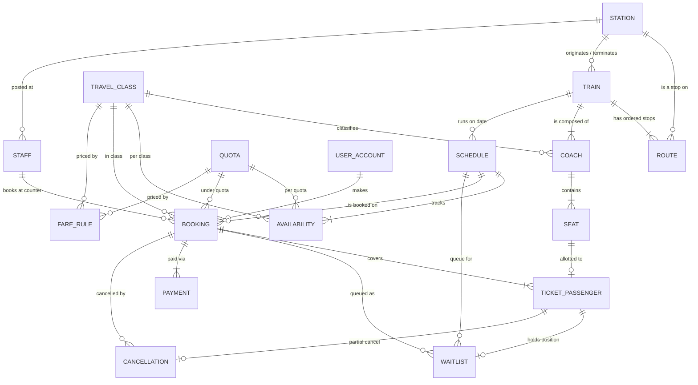
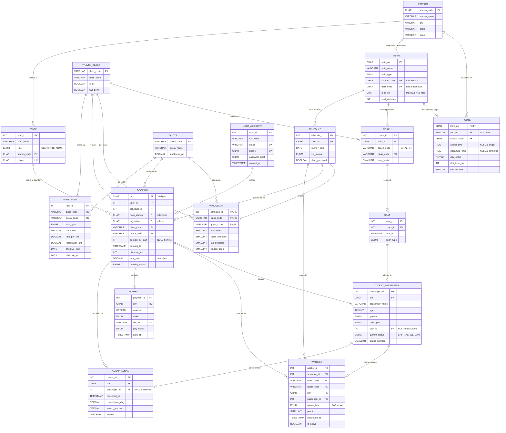

# Railway Reservation & PNR Management System

A relational database design for an Indian-Railways-style ticket reservation system — covering
train schedules, seat inventory, PNR booking, RAC/waitlist queues, fare computation, payments
and cancellations.

**DBMS Mini Project — Week 4 deliverable:** ER diagram → relational schema → DDL → execution.

---

## Table of Contents

1. [Problem Statement](#1-problem-statement)
2. [Target Users](#2-target-users)
3. [Key Queries the Database Must Serve](#3-key-queries-the-database-must-serve)
4. [ER Diagram](#4-er-diagram)
5. [ER Design Decisions](#5-er-design-decisions)
6. [Relational Schema](#6-relational-schema)
7. [ER → Relational Mapping Rules Applied](#7-er--relational-mapping-rules-applied)
8. [DDL and Constraints](#8-ddl-and-constraints)
9. [How to Run](#9-how-to-run)
10. [Execution Results](#10-execution-results)
11. [Repository Structure](#11-repository-structure)
12. [Technology Choices](#12-technology-choices)
13. [Known Limitation](#13-known-limitation)
14. [Roadmap](#14-roadmap)
15. [Level 3 Requirements Coverage](#15-level-3-requirements-coverage)

---

## 1. Problem Statement

Indian Railways handles millions of daily bookings across thousands of trains, yet manual or
fragmented ticketing leads to double-booked seats, untracked waitlists, and no reliable record of
cancellations or refunds. This project builds a centralized relational database to manage the
complete reservation lifecycle.

The system stores train details, their routes across ordered stations, coach and class-wise seat
inventory, and per-date schedules with dynamic availability. Passengers register once and book
tickets against a specific train, journey date, and boarding/destination pair; the database
generates a unique PNR, allots seats when available, and pushes the booking to a waitlist or RAC
queue otherwise. Cancellations automatically free the seat and promote the next waitlisted
passenger. Fare is computed from distance, class, and quota, and every payment or refund is logged
for audit. Integrity constraints prevent overbooking, duplicate seat allotment, and invalid station
sequences, while indexed lookups keep availability searches fast during peak booking windows.

## 2. Target Users

| User | What they do with the system |
|---|---|
| **Passenger** | Search trains, book and cancel tickets, track PNR status |
| **Reservation Clerk** | Counter bookings, modifications, refund processing |
| **Railway Administrator** | Configure trains, routes, coach composition, fare rules |
| **Ticket Examiner (TTE)** | Verify onboard seat allotment and passenger identity |

## 3. Key Queries the Database Must Serve

1. **Availability search** — for a given source, destination and date, list all trains passing
   through both stations *in the correct order*, with seats available per class.
2. **PNR status** — retrieve full booking details for a PNR: passengers, coach, seat numbers,
   CNF/RAC/WL status and current waitlist position.
3. **Waitlist promotion** — on cancellation, find the earliest-booked waitlisted passenger for that
   schedule, class and quota, and allot the freed seat.
4. **Occupancy report** — for a given train and date, compute class-wise seats booked, seats vacant
   and percentage occupancy.
5. **Revenue analytics** — total fare collected minus refunds, grouped by train and month, listing
   the top-earning routes.
6. **Passenger history** — all bookings by a user in the last year with journey details and
   cancellation/refund status.

These six queries drove the schema: note how `ROUTE.seq_no` exists purely to make query 1 correct,
and `WAITLIST.position` + `enqueued_at` exist to make query 3 deterministic.

---

## 4. ER Diagram

### Overview — entities and relationships



### Full ER diagram with attributes



> GitHub renders this Mermaid block as a diagram automatically. To export it as an image for a
> report, paste the block into <https://mermaid.live>.

### Reading the diagram

- `||--|{` = one-to-many with **total** participation on the many side (every coach *must* have seats).
- `||--o{` = one-to-many with **optional** participation (a station *may* have no trains starting there).
- `||--o|` = one-to-**zero-or-one** (a seat is allotted to at most one passenger).

## 5. ER Design Decisions

| Construct | Where it appears | Justification |
|---|---|---|
| **Weak entity** | `ROUTE` (identified by `TRAIN` + `seq_no`), `SEAT` (dependent on `COACH`) | A stop has no meaning without its train; a seat has none without its coach. |
| **Recursive / dual role** | `STATION` is both *source* and *destination* of a `TRAIN`, and both *from* and *to* of a `BOOKING` | Same entity set participating in one relationship under two distinct roles. |
| **Ternary → relationship entity** | `AVAILABILITY` (SCHEDULE × TRAVEL_CLASS × QUOTA) | A seat count is meaningful only for the combination of all three; no pair determines it. |
| **Multivalued attribute → table** | `TICKET_PASSENGER` | One PNR carries up to six passengers, each with their own seat and status. |
| **Aggregation** | `WAITLIST` refers to the *booking-on-a-schedule* relationship | A queue position is a property of a passenger already related to a schedule. |
| **Total participation** | `COACH`–`SEAT`, `BOOKING`–`TICKET_PASSENGER` | Every coach has seats; every PNR has at least one passenger. |
| **Temporal snapshot** | `BOOKING.distance_km`, `BOOKING.total_fare` | Fare rules change over time; the ticket must retain the price actually charged. |

---

## 6. Relational Schema

Primary keys in **bold**; foreign keys marked *(FK → Table)*.

1. **STATION**(**station_code**, station_name, city, state, zone)

2. **TRAIN**(**train_no**, train_name, train_type, source_code *(FK → STATION)*, dest_code *(FK → STATION)*, runs_on, total_distance)

3. **ROUTE**(**train_no** *(FK → TRAIN)*, **seq_no**, station_code *(FK → STATION)*, arrival_time, departure_time, day_offset, dist_from_src, halt_minutes)

4. **TRAVEL_CLASS**(**class_code**, class_name, is_ac, has_berth)

5. **QUOTA**(**quota_code**, quota_name, surcharge_pct)

6. **COACH**(**coach_id**, train_no *(FK → TRAIN)*, coach_code, class_code *(FK → TRAVEL_CLASS)*, total_seats)

7. **SEAT**(**seat_id**, coach_id *(FK → COACH)*, seat_no, berth_type)

8. **SCHEDULE**(**schedule_id**, train_no *(FK → TRAIN)*, journey_date, run_status, chart_prepared)

9. **AVAILABILITY**(**schedule_id** *(FK → SCHEDULE)*, **class_code** *(FK → TRAVEL_CLASS)*, **quota_code** *(FK → QUOTA)*, total_seats, seats_available, rac_available, waitlist_count)

10. **USER_ACCOUNT**(**user_id**, full_name, email, phone, password_hash, created_at)

11. **STAFF**(**staff_id**, staff_name, role, station_code *(FK → STATION)*, phone)

12. **BOOKING**(**pnr**, user_id *(FK → USER_ACCOUNT)*, schedule_id *(FK → SCHEDULE)*, from_station *(FK → STATION)*, to_station *(FK → STATION)*, class_code *(FK → TRAVEL_CLASS)*, quota_code *(FK → QUOTA)*, booked_by_staff *(FK → STAFF)*, booking_ts, distance_km, total_fare, booking_status)

13. **TICKET_PASSENGER**(**passenger_id**, pnr *(FK → BOOKING)*, passenger_name, age, gender, berth_pref, seat_id *(FK → SEAT)*, current_status, status_number)

14. **WAITLIST**(**waitlist_id**, schedule_id *(FK → SCHEDULE)*, class_code *(FK → TRAVEL_CLASS)*, quota_code *(FK → QUOTA)*, pnr *(FK → BOOKING)*, passenger_id *(FK → TICKET_PASSENGER)*, queue_type, position, enqueued_at, is_active)

15. **FARE_RULE**(**rule_id**, class_code *(FK → TRAVEL_CLASS)*, quota_code *(FK → QUOTA)*, train_type, base_fare, rate_per_km, reservation_chg, effective_from, effective_to)

16. **PAYMENT**(**payment_id**, pnr *(FK → BOOKING)*, amount, mode, txn_ref, pay_status, paid_at)

17. **CANCELLATION**(**cancel_id**, pnr *(FK → BOOKING)*, passenger_id *(FK → TICKET_PASSENGER)*, cancelled_at, cancellation_chg, refund_amount, reason)

### Domain reference

| Attribute | Allowed values |
|---|---|
| `train_type` | EXPRESS, SUPERFAST, RAJDHANI, SHATABDI, PASSENGER, VANDE_BHARAT |
| `class_code` | 1A, 2A, 3A, SL, CC, 2S |
| `quota_code` | GN (general), TQ (tatkal), LD (ladies), SS (senior), PH (divyangjan) |
| `booking_status` | CONFIRMED, RAC, WAITLISTED, PARTIAL, CANCELLED |
| `current_status` | CNF, RAC, WL, CAN |
| `berth_type` | LOWER, MIDDLE, UPPER, SIDE_LOWER, SIDE_UPPER, WINDOW, AISLE |
| `runs_on` | 7 chars of `Y`/`N`, Monday → Sunday |

## 7. ER → Relational Mapping Rules Applied

- **Strong entities** → one relation each, entity key becomes the PK
  (STATION, TRAIN, TRAVEL_CLASS, QUOTA, USER_ACCOUNT, STAFF).
- **Weak entities** → PK = owner's PK + partial key: `ROUTE(train_no, seq_no)`.
  `SEAT` uses a surrogate PK with `UNIQUE(coach_id, seat_no)` as its natural key.
- **1:N relationships** → FK on the N-side
  (`COACH.train_no`, `SEAT.coach_id`, `SCHEDULE.train_no`, `BOOKING.user_id`).
- **M:N and ternary relationships** → their own relation with a composite PK
  (`AVAILABILITY`; `FARE_RULE` for CLASS × QUOTA × train_type).
- **Multivalued attribute** (passengers on a ticket) → separate relation `TICKET_PASSENGER`.
- **Optional participation** → nullable FKs: `TICKET_PASSENGER.seat_id` is NULL until allotment,
  `BOOKING.booked_by_staff` is NULL for online bookings, `CANCELLATION.passenger_id` is NULL when
  the whole PNR is cancelled.
- **Normalization** — all 17 relations are in **3NF / BCNF**: every non-key attribute depends on the
  whole key and nothing but the key. `BOOKING.distance_km` and `BOOKING.total_fare` look derivable
  but are deliberate point-in-time snapshots, not transitive dependencies.

---

## 8. DDL and Constraints

Two equivalent scripts are provided:

| File | Target | Purpose |
|---|---|---|
| `ddl_mysql.sql` | MySQL 8.0 / InnoDB | The submission DDL |
| `ddl_sqlite.sql` | SQLite 3 | Port used to execute and verify locally |

The port changes only dialect-specific syntax: `ENUM` → `VARCHAR` + `CHECK ... IN (...)`,
`AUTO_INCREMENT` → `INTEGER PRIMARY KEY AUTOINCREMENT`, `REGEXP` → `GLOB`, and no `ENGINE=` clause.
All keys, foreign keys and semantic constraints are identical.

**Totals:** 17 tables · 33 foreign keys · 8 secondary indexes · 40+ CHECK/UNIQUE constraints.

Constraints worth pointing out:

| Constraint | Rule enforced |
|---|---|
| `chk_train_ends` | A train cannot start and end at the same station |
| `chk_bk_stations` | A ticket cannot be booked from a station to itself |
| `chk_avl` | `0 <= seats_available <= total_seats` — makes overbooking unrepresentable |
| `uq_route_stop` | A train cannot stop at the same station twice |
| `uq_wl_position` | Two passengers cannot hold the same waitlist position in one queue |
| `chk_tp_status` | A passenger marked `CNF` must have a seat allotted |
| `chk_pnr_fmt` | PNR must be exactly 10 digits |
| `chk_user_phone` | Indian mobile format — starts 6–9, 10 digits |

Indexes target the key queries directly — e.g. `idx_route_station` for availability search,
`idx_wl_queue` for waitlist promotion, `idx_booking_sched` for occupancy reports.

## 9. How to Run

**Verify the schema (no database server needed — uses Python's bundled SQLite):**

```bash
git clone https://github.com/Chunnu-Munnu/DBMS-JOB.git
cd DBMS-JOB
python run_ddl.py
```

This drops any existing `railway.db`, executes `ddl_sqlite.sql`, prints every table with its column
and foreign-key counts, runs `PRAGMA foreign_key_check` and `PRAGMA integrity_check`, then
deliberately attempts nine invalid inserts to prove each constraint actually fires.

**Load into MySQL:**

```bash
mysql -u root -p < ddl_mysql.sql
mysql -u root -p -e "USE railway_db; SHOW TABLES;"
```

`ddl_mysql.sql` begins with `DROP DATABASE IF EXISTS railway_db;` — it recreates the schema from
scratch, so do not run it against a database holding data you want to keep.

## 10. Execution Results

```
TABLES CREATED: 17          EXPLICIT INDEXES: 8
fk_check  : PASS (no violations)
integrity : ok

CONSTRAINT SMOKE TEST
  duplicate station PK                   rejected: UNIQUE constraint failed: STATION.station_code
  train with source = destination        rejected: CHECK constraint failed: chk_train_ends
  train referencing unknown station      rejected: FOREIGN KEY constraint failed
  invalid train_type value               rejected: CHECK constraint failed: chk_train_type
  negative total_distance                rejected: CHECK constraint failed: chk_train_dist
  malformed runs_on flags                rejected: CHECK constraint failed: chk_runs_on
  bad phone format on USER_ACCOUNT       rejected: CHECK constraint failed: chk_user_phone
  email without @                        rejected: CHECK constraint failed: chk_user_email
  two stops at same seq_no               rejected: UNIQUE constraint failed: ROUTE.train_no, seq_no
```

Every invalid insert was rejected by the correct **named** constraint — the constraints are
demonstrably live, not merely declared.

| Table | Cols | FKs | | Table | Cols | FKs |
|---|---|---|---|---|---|---|
| STATION | 5 | 0 | | BOOKING | 12 | 7 |
| TRAIN | 7 | 2 | | TICKET_PASSENGER | 9 | 2 |
| ROUTE | 8 | 2 | | WAITLIST | 10 | 5 |
| TRAVEL_CLASS | 4 | 0 | | FARE_RULE | 9 | 2 |
| QUOTA | 3 | 0 | | PAYMENT | 7 | 1 |
| COACH | 5 | 2 | | CANCELLATION | 7 | 2 |
| SEAT | 4 | 1 | | STAFF | 5 | 1 |
| SCHEDULE | 5 | 1 | | USER_ACCOUNT | 6 | 0 |
| AVAILABILITY | 7 | 3 | | **Total** | **113** | **33** |

## 11. Repository Structure

```
.
├── README.md                       # This file — full project documentation
├── ER_and_Relational_Schema.md     # Detailed ER + schema write-up
├── ddl_mysql.sql                   # Submission DDL (MySQL 8.0 / InnoDB)
├── ddl_sqlite.sql                  # SQLite port, used for verification
├── run_ddl.py                      # Executes the DDL and validates the schema
└── docs/
    └── DBMS Level 3 Project Requirements.pdf   # Course brief this project is built against
```

`railway.db` is generated by `run_ddl.py` and is intentionally **not** committed — it is a build
artifact, reproducible in one command.

## 12. Technology Choices

| Layer | Choice | Why |
|---|---|---|
| **Primary DB** | MySQL 8.0 (InnoDB) | The data is highly relational and normalized; needs FK enforcement and transactions for booking atomicity. |
| **Secondary DB (NoSQL)** | Redis 7 | Seat availability is the hottest read in the system and changes constantly — a key-value store with native queue structures fits it better than another relational table. |
| **Verification** | SQLite | Zero-setup, lets anyone validate the schema without installing a server. |

Redis is the second database paradigm required by the brief. It is a key-value NoSQL store, and it
is here because the workload genuinely needs one — not to tick the box:

- Cache `train:12345:2026-09-10:3A → seats available`, so availability search never hits MySQL.
- `SETNX` distributed lock on a seat during the booking window, preventing double allotment
  under concurrent bookings.
- Sorted set keyed by booking timestamp as the live waitlist queue — `ZPOPMIN` returns the next
  passenger to promote in O(log n), which is exactly query 3.

The waitlist sorted set is also the project's NoSQL advanced feature: promotion is a single
`ZPOPMIN` in O(log n), where the equivalent SQL is an ordered scan of the queue under a lock.

Vector databases (Pinecone, Chroma, pgvector) were considered and rejected: there is no
embedding-worthy content in a reservation system, so adding one would be unmotivated. MongoDB was
rejected because the core data is highly relational — the opposite of its strength. Neo4j is a
genuine alternative if route-finding across the network becomes the centrepiece rather than
booking.

## 13. Known Limitation

One integrity rule is **not** expressible as a table constraint: *the same physical seat must not be
allotted twice on the same schedule*.

`TICKET_PASSENGER` holds `seat_id` but not `schedule_id` — it reaches the schedule indirectly
through `BOOKING`. A plain `UNIQUE(seat_id)` would be wrong, since it would block the same seat
being reused on a different date. This is therefore enforced in the DML phase by a
`BEFORE INSERT` trigger on `TICKET_PASSENGER` that joins through `BOOKING` to the schedule, backed
by the Redis seat-lock during the booking window.

It is documented here rather than silently omitted.

## 14. Roadmap

- [x] **Week 4** — ER diagram, relational schema, DDL, execution
- [ ] Seed data (stations, trains, routes, coaches, fare rules)
- [ ] DML: the six key queries as tested SQL (JOIN, GROUP BY, HAVING, ORDER BY, aggregates, subqueries)
- [ ] `ALTER` / `DROP` migration script, plus views (`v_pnr_status`, `v_occupancy`, `v_revenue`)
- [ ] Triggers: seat-uniqueness, availability decrement, automatic waitlist promotion
- [ ] Stored procedures: `book_ticket()`, `cancel_ticket()`, `compute_fare()`
- [ ] Transactions with explicit isolation for the booking path
- [ ] Redis caching layer for availability and the waitlist queue
- [ ] Next.js web interface — search, booking, PNR status, admin dashboard
- [ ] Auth: passenger and admin roles, bcrypt password hashing, `.env` database config

---

## 15. Level 3 Requirements Coverage

Where each Level 3 project requirement is (or will be) satisfied.

| # | Requirement | Status | Where |
|---|---|---|---|
| 1 | Unique title, non-trivial problem | Done | §1 — RAC/waitlist queues, fare snapshots and occupancy analytics go well beyond CRUD |
| 2 | 2-member team | Done | [Team](#team) |
| 3 | SQL (mandatory) + a second paradigm | Design fixed | MySQL 8.0 (relational) + Redis (key-value NoSQL) — justified in §12 |
| 4 | ER diagram → relational schema, keys, constraints | Done | §4, §6, §7 |
| 5 | DDL: CREATE, ALTER, DROP, keys, constraints, indexes, views | CREATE done | `ddl_mysql.sql`; ALTER/DROP and views scheduled in §14 |
| 6 | DML: INSERT, UPDATE, DELETE, SELECT with JOIN/GROUP BY/subqueries | Planned | §3 lists the six queries driving this |
| 7 | ≥4 advanced SQL features + 1 NoSQL | Planned | SQL: transactions, views, stored procedures, triggers, indexing (§8 already). NoSQL: Redis sorted-set waitlist queue with `ZPOPMIN` promotion — §12 |
| 8 | Vector DB / semantic search (optional) | Deliberately skipped | §12 explains why embeddings are unmotivated here |
| 9 | Next.js web interface | Planned | §14 |
| 10 | DB–app integration, no hard-coded credentials | Planned | `.env` + Next.js route handlers |
| 11 | Auth with ≥2 roles | Planned | `USER_ACCOUNT` (passenger) and `STAFF.role` — CLERK / TTE / ADMIN already modelled |
| 12 | Validation and integrity at the database level | Done | §8 — 40+ CHECK/UNIQUE constraints, verified live in §10 |
| 13 | Security — no plain-text credentials | Done in schema | `USER_ACCOUNT.password_hash`; bcrypt at the application layer |
| 14 | Documentation | In progress | This README + `ER_and_Relational_Schema.md`; screenshots and test results follow the app |
| 15 | Git/GitHub | Done | Repository maintained on GitHub; this README covers setup and execution |
| 17 | Originality | Done | Schema, constraints and query set designed from scratch for this project |

The full brief is kept in the repository at `docs/DBMS Level 3 Project Requirements.pdf`.

---

## Team

| Name | Roll No. |
|---|---|
| Aariz Qureshi | PES1UG24CS008 |
| Amogh Sharma | PES1UG24CS053 |

*DBMS Mini Project · PES University*
