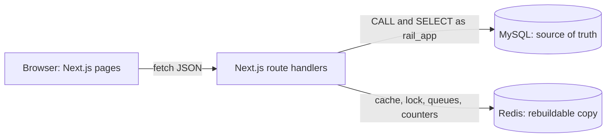
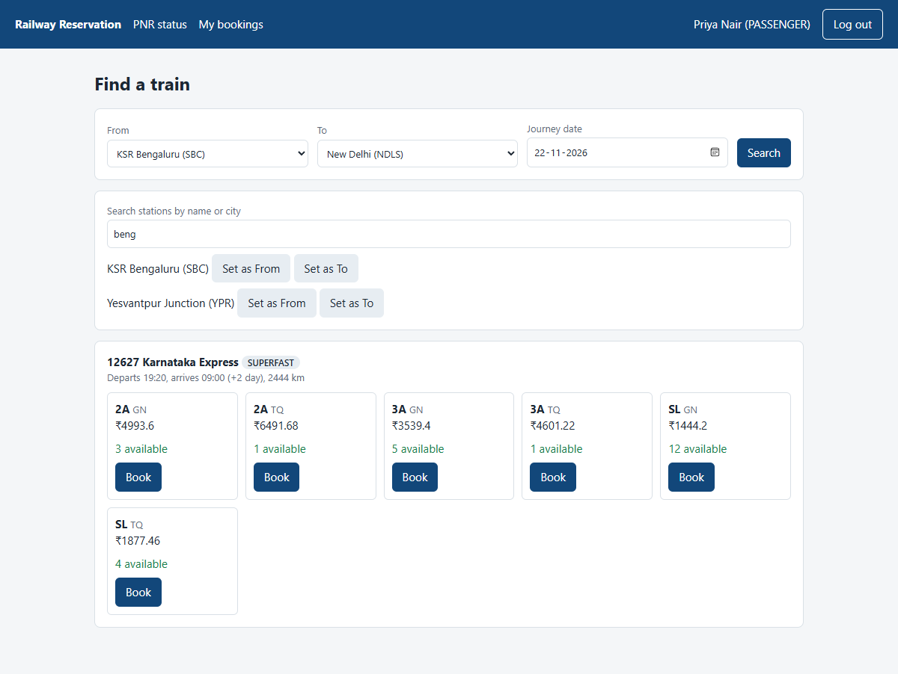
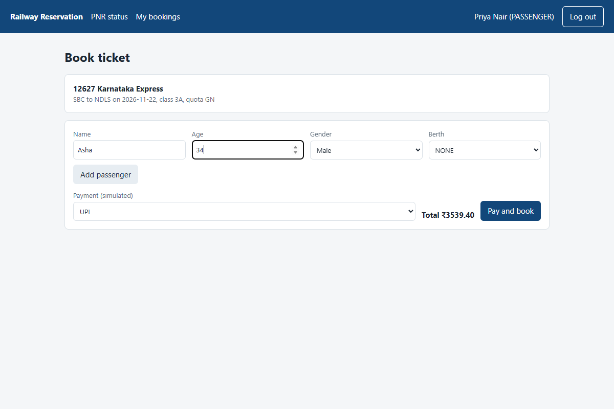
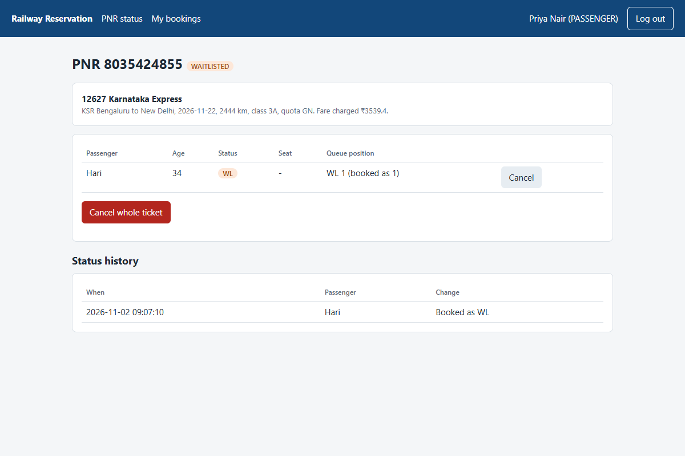
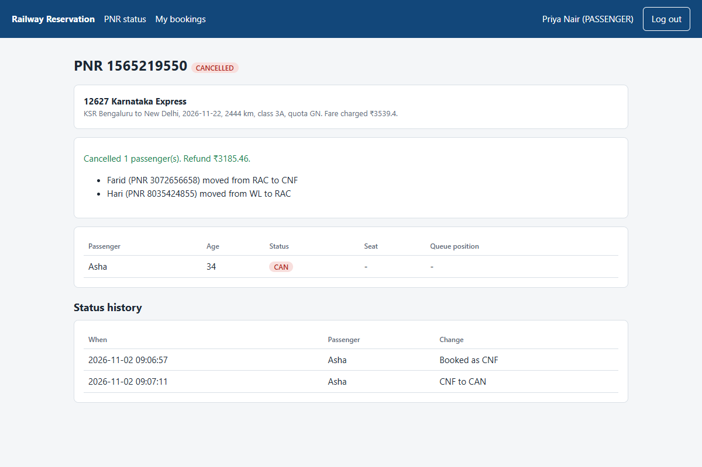
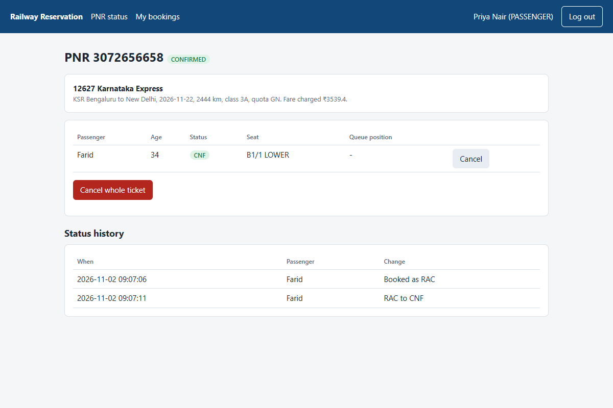
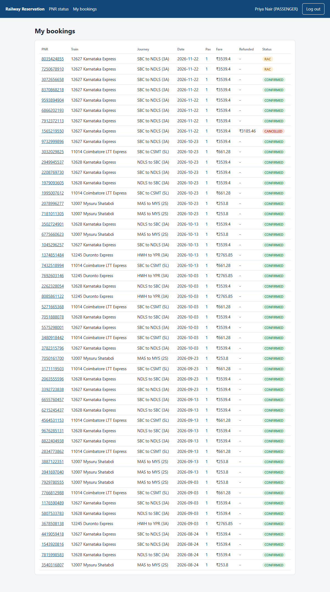
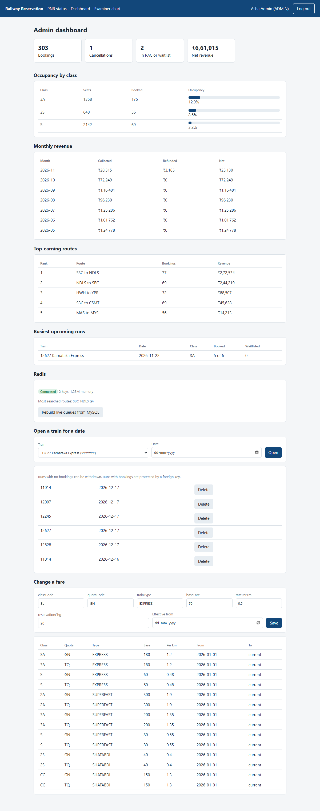
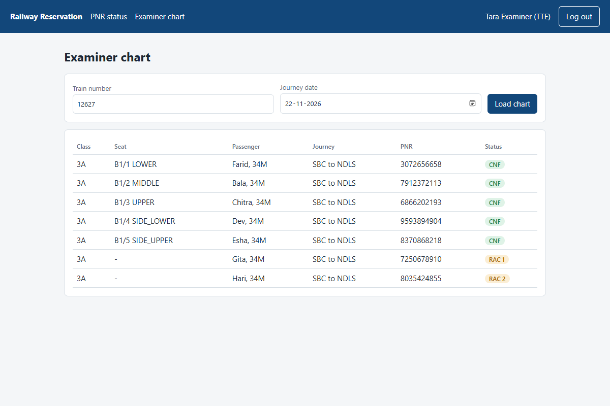

# Railway Reservation & PNR Management System: Project Report

## 1. Problem Statement

Indian Railways handles millions of bookings across thousands of trains. Fragmented ticketing leads
to double-booked seats, untracked waitlists and unclear refunds. This project builds a centralised
reservation system in which those failures are prevented by the database itself.

## 2. Objectives

- Model trains, ordered routes, per-date schedules, seats, quotas and fares in a normalised schema.
- Make overbooking and double seat allotment impossible, including under simultaneous requests.
- Promote RAC and waitlisted passengers automatically and deterministically after a cancellation.
- Keep a complete audit trail of payments, refunds and ticket status changes.
- Give passengers, clerks, examiners and administrators a role-appropriate web interface.

## 3. Scope

**In scope:** search, booking of up to six passengers, RAC and waitlist, partial and full cancellation,
refunds, PNR status, counter booking, examiner chart, reports, fare and schedule management.

**Out of scope:** a real payment gateway (payments are recorded but simulated), berth sharing for RAC,
and reuse of one seat across non-overlapping segments of a journey.

## 4. Functional Requirements

| # | Requirement | Role |
|---|---|---|
| F1 | Register, log in, log out | All |
| F2 | Search trains by source, destination and date, in the correct direction | All |
| F3 | See availability and fare per class and quota | All |
| F4 | Book 1 to 6 passengers; receive CNF, RAC or WL for each | Passenger, clerk |
| F5 | View PNR status, live queue position and status history | All |
| F6 | Cancel one passenger or a whole ticket and receive a refund | Owner, clerk, admin |
| F7 | Promote the queue automatically on cancellation | System |
| F8 | View booking and cancellation history for the last year | Passenger |
| F9 | View the chart of passengers for a run | Examiner, admin |
| F10 | View occupancy, revenue and top routes | Admin |
| F11 | Open or withdraw a run; change a fare without altering history | Admin |

## 5. ER Diagram and Relational Schema

- ER diagram: [ER_diagram.pdf](ER_diagram.pdf), source [er-diagram.mmd](er-diagram.mmd)
- Relational schema: [Relational_schema.pdf](Relational_schema.pdf), [relational-schema.md](relational-schema.md)

## 6. Database Choice and Justification

| Data | Store | Why |
|---|---|---|
| Trains, bookings, seats, payments | MySQL 8 (InnoDB) | Highly related data; needs foreign keys, ACID transactions and row locks |
| Search results | Redis string with TTL | Read far more often than written; safe to lose and rebuild |
| Booking window lock | Redis `SET NX PX` | Short-lived, expires by itself if a process dies |
| Live queue positions | Redis sorted set | `ZRANK` returns a rank in O(log n) |
| Trending routes | Redis sorted set | `ZINCRBY` is an atomic counter, and these searches need no durable record |
| Login throttle | Redis `INCR` with expiry | The counter resets itself after 15 minutes |

MongoDB was rejected because the core data is strongly relational. A vector database was rejected
because a reservation system has no free text or similarity search that embeddings would serve.

## 7. Data Dictionary

See the attribute lists in [relational-schema.md](relational-schema.md) and the column comments in
`database/01_schema.sql`.

Redis keys:

| Key | Type | Value | Expiry |
|---|---|---|---|
| `search:{from}:{to}:{date}` | String | JSON search result | 60 s |
| `sched:{id}:searches` | Set | Search keys that include this run | 120 s |
| `lock:{schedule}:{class}` | String | Random owner token | 3 s |
| `queue:{schedule}:{class}:{quota}:{RAC or WL}` | Sorted set | Member passenger id, score position | None; rebuilt from MySQL |
| `trending:routes` | Sorted set | Member `FROM-TO`, score search count | None |
| `login:fail:{email}` | String | Failed attempt count | 15 min |

## 8. Implementation

| Feature | Where |
|---|---|
| DDL: CREATE, ALTER, DROP, TRUNCATE | `01_schema.sql`, `02_alter_auth_audit.sql`, `alter_drop_demo.sql` |
| Transactions and row locks | `sp_book_ticket`, `sp_cancel_ticket`, `sp_create_schedule`, `sp_set_fare` |
| Stored functions | `fn_compute_fare`, `fn_refund_pct`, `fn_free_seat`, `fn_new_pnr` |
| Triggers | `04_triggers.sql` |
| Views | `v_pnr_status`, `v_occupancy`, `v_revenue`, `v_passenger_history` |
| Indexes | End of `01_schema.sql`, `02_alter_auth_audit.sql` |
| Full-text search | `08_fulltext.sql`, `GET /api/stations?q=` |
| NoSQL | `web/lib/redis.ts` |

## 9. Important Queries

All are in [`database/queries.sql`](../database/queries.sql): the six key queries, plus correlated and
uncorrelated subqueries, a FROM subquery, outer join, set operation, CTE, window functions, full-text
search and an `EXPLAIN`.

## 10. System Architecture

The two databases never talk to each other. The API writes to MySQL first and updates Redis only after
the commit. If Redis is down the app carries on using MySQL. If MySQL is down the API returns 503.

## 11. Application Screenshots

| | |
|---|---|
| Search with full-text station finder |  |
| Booking form |  |
| Waitlisted ticket |  |
| Cancellation showing promotions |  |
| Promoted passenger with history |  |
| Booking history |  |
| Admin dashboard |  |
| Examiner chart |  |

## 12. Testing Results

`npm test` runs end-to-end cases against the running app and a freshly seeded database.
The last full output is in [test-results.txt](test-results.txt).

| Scenario | Result |
|---|---|
| Redis up | All cases pass, including 30 simultaneous bookings giving exactly 5 CNF, 2 RAC, 23 WL |
| Redis stopped | App keeps working; every non-Redis case passes and the Redis cases are skipped |
| MySQL stopped | API returns 503 with a clear message and recovers without a restart |

## 13. Conclusion and Future Enhancements

The project shows that correctness can live in the database: constraints, triggers and locking
transactions hold regardless of the application code above them.

Future work: seat reuse across non-overlapping segments, RAC berth sharing, a real payment gateway,
read replicas for search, and scheduled chart preparation using `chart_prepared`.
